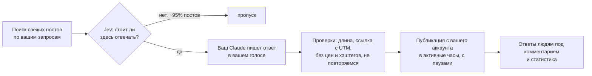

<div align="center">

# Comments Factory

**Ваш аккаунт отвечает людям сам. Полезно, по-человечески и только там, где это уместно.**

X и Threads · несколько продуктов на одном аккаунте · ваш голос, ваши факты, ваши лимиты

<sub>работает на вашем Mac · руки: Aside Browser · отбор постов: Jev · текст: ваш Claude</sub>

</div>

---

## Зачем это

Самые тёплые клиенты приходят из комментариев: кто-то спросил «какую eSIM взять в Турцию», вы ответили по делу, человек зашёл в профиль и купил. Проблема одна: чтобы так происходило каждый день, нужно каждый день читать ленты, находить правильные посты и писать. Comments Factory делает это за вас, но от вашего имени и по вашим правилам.

Он не рассылает рекламу и не пишет «лучшие цены, переходите по ссылке». Он находит свежие посты, где ваш опыт действительно помогает, отвечает так, как ответили бы вы, и упоминает продукт только когда это естественно вытекает из темы.

## Как это выглядит для вас

Панель в браузере на вашем компьютере, пять экранов:

| Экран | Что там |
|---|---|
| **Обзор** | Сколько опубликовано сегодня и за неделю, график за две недели, статистика профилей, последние комментарии и запуски |
| **Очередь** | Черновики, если вы выбрали режим «С подтверждением»: поправить текст, одобрить или отклонить |
| **Комментарии** | Всё, что опубликовано, и ответы людей под нашими комментариями |
| **Настройки** | Продукты, правила для X и Threads, модели |
| **Журнал** | Каждый запуск: что искали, что нашли, что опубликовали |

Сверху на каждой странице строка команд: можно сказать голосом или написать «поставь для Threads лимит 6 в день» или «добавь запрос интернет в Турции», панель покажет изменение и применит после вашего «да».

Три режима на каждую площадку:

- **Только черновики** — ищет и пишет, ничего не публикует. Для знакомства.
- **С подтверждением** — публикует только то, что вы одобрили в очереди.
- **Автоматически** — публикует сам в пределах лимитов и активных часов.

## Как это работает



1. **Поиск.** Для каждого продукта свой список запросов: «какую симку взять», «первый раз за границу», «летим в». X ищется через API вашей залогиненной сессии, Threads открывается как настоящая вкладка.
2. **Отбор.** Каждый найденный пост оценивает Jev (о нём ниже). Проходят единицы.
3. **Текст.** Отобранные посты получают ответ от модели, подключённой к вашему Aside, обычно это Claude. Она знает только факты, которые вы вписали в карточку продукта, и ничего не выдумывает: ни личных поездок, ни цен, которых нет в фактах.
4. **Проверки.** Автоматические фильтры режут то, что портит репутацию: продающие хвосты «напишите мне в личку», хэштеги, вторую ссылку, цену там, где она запрещена. Если текст не прошёл, модель переписывает его один раз.
5. **Публикация.** С вашего аккаунта, в активные часы вашей аудитории, с паузами между комментариями, не больше N в день, одному автору не чаще раза в месяц, под одним постом только один раз.
6. **После.** Раз в несколько часов собираются лайки и ответы. Если под нашим комментарием задали вопрос или проявили интерес, отвечаем; на «спасибо» ставим лайк; в споры не вступаем.

## Jev: как мы выбираем посты

Из ста свежих постов по запросу «роуминг» ответа заслуживают два-три. Остальное реклама, новости, шутки, чужие споры и посты не на том языке. Классический способ отбирать такое: просить большую языковую модель «подумать» над каждым постом. Это медленно, дорого и каждый раз по-разному.

Comments Factory использует **Jev** от TypeSafe. Это не чат-модель, а модель решений: ей показывают пост и задают несколько точных вопросов, а она сразу отдаёт откалиброванные числа, без рассуждений и без текста.

Для каждого поста мы спрашиваем:

| Вопрос | Ответ Jev |
|---|---|
| Это про нашу тему? | вероятность от 0 до 1 |
| Что это: вопрос, обсуждение, знакомство, реклама, новость, прочее? | выбор |
| Насколько полезным будет наш ответ именно здесь? | оценка от 0 до 3 |
| На каком языке написано? | выбор |
| Рискованно ли отвечать: политика, трагедия, бренд, бот, конкурент? | вероятность от 0 до 1 |

Дальше работают пороги из настроек: релевантность не ниже 0,6, польза не ниже 1,2, риск не выше 0,35, язык из списка продукта. Пороги можно крутить, и это главный рычаг «строже или шире».

Что это даёт на практике:

- **Предсказуемость.** Одинаковые критерии к каждому посту, без настроения модели. В журнале видно, почему пост пропущен: «relevance 0.53», «kind=ad», «risk 0.66».
- **Экономия.** Jev не тратит токены на размышления: он не пишет текст, а отдаёт числа. В наших запусках оценка 140 постов стоила около половины цента. Дорогая модель пишет только для тех 3–5% постов, что прошли отбор, и это основная причина, почему продукт стоит копейки в день.
- **Скорость.** Десятки постов в секунду, поэтому можно смотреть широко и выбирать узко.

## Текст пишет ваш Claude

Модель для текста берётся из вашего Aside (по умолчанию Claude через провайдер claude-code). Сторонних сервисов для генерации текста нет: Comments Factory передаёт Aside промпт с фактами продукта и правилами, получает JSON и проверяет его.

Правила, которые модель получает всегда:

- говорить от первого лица как основатель («я сам делаю такой сервис»), никогда не притворяться довольным клиентом;
- не выдумывать личный опыт и факты, которых нет в карточке продукта;
- 2–4 предложения, без восклицательных штампов, без «лучший» и «скидка», максимум одно эмодзи;
- продукт упоминать только когда тема касается связи, оплаты, аэропорта, сборов, и не чаще заданной доли комментариев;
- ссылка не чаще заданной доли, всегда с UTM этой площадки (UTM подставляется автоматически, даже если модель её забыла);
- никаких продающих хвостов вроде «скажи даты, подберу» в первом комментарии.

## Безопасность аккаунта

Автоматизация формально нарушает правила X и Meta, поэтому продукт ведёт себя как аккуратный человек, а не как бот:

| Защита | По умолчанию |
|---|---|
| Комментариев в день | X: 4 · Threads: 4 (можно больше) |
| Пауза между комментариями | X: 60 мин · Threads: 3 мин |
| Активные часы | в поясе аудитории, например 9–22 по Сан-Паулу |
| Один автор | не чаще раза в 30 дней |
| Один пост | только один раз, даже если комментировал другой инструмент |
| Ошибка, капча, ограничение | немедленная пауза на 24 часа с причиной на обзоре |

Используйте только свои аккаунты. Ответственность за аккаунт лежит на его владельце.

## Что нужно, чтобы запустить

- Mac, который не засыпает (Mac mini или Mac Studio подходят идеально).
- Aside Browser с входом в ваши X и Threads и подключённым Claude.
- Ключ OpenRouter для Jev.
- Десять минут на карточку продукта: что это, кому, какие факты можно называть, ссылки, запросы.

Пошаговая установка, в том числе для вашего ИИ-агента: **[INSTALL.md](INSTALL.md)**.

<details>
<summary><b>Для разработчиков: как устроено внутри</b></summary>

Comments Factory это обычный Node-сервис (Node 24, TypeScript без сборки, Hono, SQLite) на машине владельца аккаунтов: launchd-служба и панель на localhost. Планировщик сам решает, когда искать, писать и публиковать. Aside Browser используется как «руки»: через `aside repl` ему передаётся JavaScript, который выполняется внутри залогиненных сессий. Для X Aside даёт объект `twitter` (поиск, ответ, лайк, чтение твита, уведомления), для Threads открывается вкладка и выполняются клики и набор текста по DOM. Текст пишет модель из Aside через `aside exec`. Единственный внешний сервис это OpenRouter, и только для Jev (`/api/alpha/decisions`).

```
src/
  cli.ts                команды: serve, doctor, x:*, threads:*
  server/               панель: index.ts страницы, settings.ts настройки, views.ts оформление
  runner/x.ts           X: discover → Jev → draft → post → stats
  runner/threads.ts     Threads: import memory → inbound → discover → Jev → draft → post → stats → insights
  runner/scheduler.ts   тикер раз в минуту: X по интервалу, Threads по расписанию, публикация одобренного, doctor
  lib/threads-browser.ts код для Aside REPL: поиск, ответ, лайк, лента «Действия», «Ответы», «Статистика»
  lib/aside.ts          обёртка над aside repl / aside exec
  lib/openrouter.ts     /alpha/decisions (Jev)
  lib/jev.ts            вопросы Jev для отбора постов и классификации входящих
  lib/draft.ts          черновики + валидаторы (ссылки, UTM, цены, хэштеги, продающие хвосты)
  lib/limits.ts         лимиты, окна, паузы, кулдауны авторов, дедуп по постам
  lib/settings.ts       дефолты по платформам
data/                   SQLite и логи (в .gitignore)
```

Если на том же аккаунте раньше работала рутина Aside, её память импортируется: продукт не ответит дважды одному автору или под одним постом и подхватит ответы людей под старыми комментариями.

</details>
